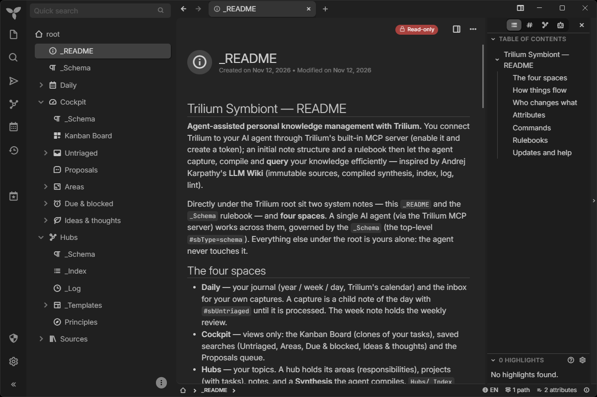
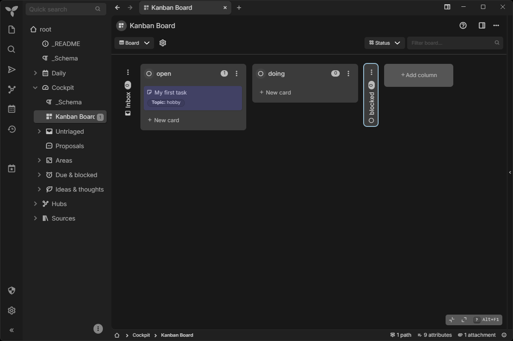
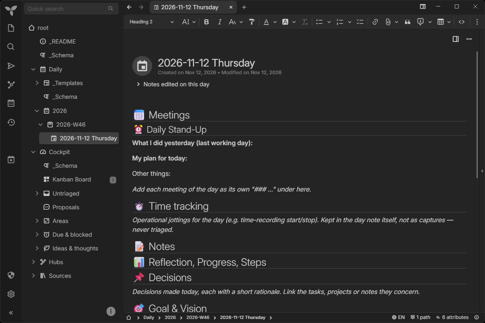

# trilium-symbiont

**A symbiotic second brain in Trilium:** an AI agent maintains the wiki and workspace, you edit and
override at any time.

**Agent-assisted personal knowledge management with Trilium.** You connect Trilium to your AI agent
(Kiro, Claude Code or Claude Desktop) through Trilium's **built-in MCP server**; `/sb-init` then sets up
an initial note structure and a rulebook so the agent can capture, compile and **query** your knowledge
efficiently — inspired by [Andrej Karpathy's LLM Wiki](https://gist.github.com/karpathy/442a6bf555914893e9891c11519de94f)
(immutable sources → compiled synthesis → index, log, lint).

## How it works

Four **spaces** sit directly under the Trilium root, next to two system notes, `_README` (the user guide)
and `_Schema` (the rulebook the agent reads first). Everything else under the root stays off-limits for
the agent.

- **Daily** — your journal and the inbox for quick captures.
- **Cockpit** — views: the Kanban Board, saved searches, the queue of agent proposals.
- **Hubs** — your topics with their areas, projects, tasks and notes, plus a **synthesis** per hub that
  the agent compiles, every statement linked to its source.
- **Sources** — foreign material (articles, documentation, research), kept unchanged.



The Kanban Board in Cockpit holds a clone of every task; its columns are yours to change:



A day note in Daily, created from the Day template; captures become its child notes:



You **capture** during the day, **triage** into hubs, let the agent **ingest** sources into syntheses
and **query** the system; the tree stays yours — the agent proposes, you decide. The full user guide,
with every command and example, is the `_README` note in your Trilium; you can also read it here:
[`skills/sb-init/assets/_README.md`](skills/sb-init/assets/_README.md).

## What's tracked here

| Path | What it is |
|------|------------|
| `skills/sb-*/` | The twelve operation-centric skills, each a folder with a `SKILL.md` in the [Agent Skills](https://agentskills.io) format: `sb-capture`, `sb-triage`, `sb-research`, `sb-ingest`, `sb-query`, `sb-lint`, `sb-task`, `sb-daily`, `sb-hub`, `sb-review`, and for setup and maintenance **`sb-init`** (bootstraps an empty instance) and **`sb-sync`** (one-way repo→live update within one major version). |
| `skills/sb-init/assets/skeleton.md` | **Build specification** of the tree: every skeleton note in order with type, labels, relations, icon; journal defaults; Board defaults; saved searches. Read by `sb-init` and `sb-sync`. |
| `skills/sb-init/assets/_Schema-umbrella.md` | **Umbrella rulebook** — read first every session: scope, spaces, `#sb*` attributes, `#sbControl`, security, retrieval. Lives in Trilium as the top-level `#sbType=schema` note (`#sbVersion=1.0.0`). |
| `skills/sb-init/assets/{daily,cockpit,hubs,sources}/_Schema.md` | **Space rulebooks** — journal and captures; Board, saved searches, proposals; hubs, syntheses, concepts, Principles; immutable sources and the ingest queue. Each is the `#sbType=schema` note within its space root. |
| `skills/sb-init/assets/_README.md` | The **user guide**, shown on the top-level `_README` note: spaces, flow, who changes what, attributes, every command with examples. |
| `skills/sb-init/assets/templates/` | **Templates** `day.md`, `week.md` (Trilium journal; the week note is the weekly review), `hub.md`, `synthesis.md`. This is the only copy: `sb-daily` (day, week) and `sb-hub` (hub, synthesis) read their fallback templates from here, and the build script bundles them into those skills' Claude Desktop ZIPs. |
| `AGENTS.md` (+ `CLAUDE.md`, which imports it) | **Rules for AI agents editing this repo** — the hard constraints that keep the skills working in Kiro, Claude Code and Claude Desktop on Windows and Linux. Kiro and Claude Code load it automatically. |
| `scripts/check_repo.py` · `scripts/check_repo.mjs` | Checks the repo against those decisions. Run it before every commit. |
| `scripts/build_dist.py` · `scripts/build_dist.mjs` | Builds the Claude Desktop skill ZIPs into `dist/` (`[sb-name …]` builds only those). Adds the shared templates to the `sb-daily` and `sb-hub` ZIPs. |
| `scripts/install.sh` · `scripts/install.ps1` | Installs the skills and the steering for Kiro and/or Claude Code as links (bash / PowerShell, no other runtime). See *Installing*. |
| `scripts/shared-assets.json` | Which skill uses which file of another skill (today: the templates of `sb-init`). Read by both script pairs. |
| `.github/workflows/check.yml` | CI on every push and pull request: both check twins, both build twins (identical ZIPs), the bash installer on Linux and the PowerShell installer on Windows. |
| `.github/workflows/release.yml` | When a GitHub release is published: builds the Claude Desktop ZIPs from its tag and attaches them to the release. |
| `CHANGELOG.md` | What changed in each release and what you have to do to upgrade. |
| `docs/adr/` | Architecture decision records: why the non-obvious rules in `AGENTS.md` are the way they are. |
| `docs/img/` | Screenshots used in this README and in `docs/install.md`. |
| `docs/install.md` | Every install step by hand: token, MCP server, steering and skills per client, Claude Desktop ZIPs, skeleton build, upgrades. |
| `steering/trilium-symbiont.md` | Always-on steering: natural-language routing + scope + the status-marker rule. |

**Every script exists twice — in Python and in Node** — with the same behavior and output, so you need
only one of the two runtimes (Python ≥ 3.8 or Node ≥ 18, no dependencies). Use whichever you have:

| | Python | Node |
|---|--------|------|
| Check (bash) | `python3 scripts/check_repo.py` | `node scripts/check_repo.mjs` |
| Check (PowerShell) | `py scripts\check_repo.py` | `node scripts\check_repo.mjs` |
| Build ZIPs (bash) | `python3 scripts/build_dist.py [sb-name …]` | `node scripts/build_dist.mjs [sb-name …]` |
| Build ZIPs (PowerShell) | `py scripts\build_dist.py [sb-name …]` | `node scripts\build_dist.mjs [sb-name …]` |

> The rulebooks and templates live **inside the `sb-init` skill** (`assets/` = files the skill copies
> verbatim into Trilium), so the skill is self-contained wherever it is installed — including a Claude
> Desktop ZIP. `sb-sync` reads them from the repo or, in Claude Desktop, from the
> installed `sb-init` skill.
>
> Everything is **ID-free**: the agent finds every note by label/position (`#sbSpace`, `#sbType`,
> ancestry), never by a hard noteId — so the same files work on every Trilium instance (e.g. a private
> and a business one).

## Commands

Every workflow is started by you — with a slash skill or in plain language, in any language (the steering
file routes plain prompts to the right skill; in Claude Desktop, name the skill: *"use sb-triage"*):
`/sb-capture` · `/sb-triage` · `/sb-task` · `/sb-daily` · `/sb-query` · `/sb-research` · `/sb-ingest` ·
`/sb-hub` · `/sb-review` · `/sb-lint`, and for setup and maintenance `/sb-init` · `/sb-sync`. What each one
does, with examples: the [user guide](skills/sb-init/assets/_README.md#commands).

## Supported AI clients

The skills and the steering are plain Markdown and work with **Kiro**, **Claude Code** and **Claude
Desktop**. Kiro and Claude Code **link** to this repo (symlinks / junctions), so an edit here is live at
once; Claude Desktop gets uploaded ZIPs.

| Piece | Kiro | Claude Code | Claude Desktop |
|-------|------|-------------|----------------|
| Trilium MCP server | `~/.kiro/settings/mcp.json` | `claude mcp add` (stored in `~/.claude.json`) | `claude_desktop_config.json` |
| Steering | linked into `~/.kiro/steering/` | imported from `~/.claude/CLAUDE.md` (absolute path into the repo) | project instructions of a Claude project |
| Skills (`sb-*/` folders) | linked into `~/.kiro/skills/` | linked into `~/.claude/skills/` | uploaded as ZIP (Settings → Skills) |

In every client the MCP server must be named **`trilium`**.

## Installing

**You need:** a running **Trilium ≥ 0.107.0** ([download](https://triliumnotes.org/get-started/)) with its built-in MCP server enabled (Options → AI/LLM), an
ETAPI token (Options → ETAPI) stored in the user environment variable `TRILIUM_TOKEN`, and Kiro, Claude
Code or Claude Desktop. Details, including how to set the variable on each OS:
[docs/install.md](docs/install.md#prerequisites).

Clone the repo and keep it where it is (the skill links point into it):
```
git clone https://github.com/chaeller/trilium-symbiont.git
cd trilium-symbiont
```

### Quick install: let your AI agent do it (Kiro, Claude Code)

Open Kiro or Claude Code **in the cloned folder** and paste this prompt. The agent runs the install
script, guides you through the MCP setup and checks the result.

```text
Install Trilium Symbiont from this repository for the AI client you are running in.
1. Read README.md, docs/install.md and AGENTS.md. Find out my OS and which client you are
   (Kiro or Claude Code).
2. Run the install script for my OS with the dry-run option first, show me what it would change,
   and run it for real only after I confirm:
   Linux/macOS: scripts/install.sh --claude-code | --kiro [--dry-run]
   Windows:     powershell -ExecutionPolicy Bypass -File scripts\install.ps1 -ClaudeCode | -Kiro [-DryRun]
   Do not create or delete the links yourself; only the script does that.
3. Guide me through connecting the Trilium MCP server under the name "trilium" for this client,
   exactly as docs/install.md describes. Never ask me for my Trilium token and never write it into a
   file or command: I set the TRILIUM_TOKEN environment variable myself. Ask for my Trilium URL.
4. Verify what you can (e.g. `claude mcp get trilium` for Claude Code), then tell me to start a new
   session and run /sb-init on an empty Trilium instance, or /sb-lint on an existing one.
```

**Without an agent** — or with **Claude Desktop**, which can't run scripts and installs the skills as ZIP
uploads: every step by hand, per client and OS, is in [docs/install.md](docs/install.md). Claude Desktop
needs no clone: download the skill ZIPs from the [latest release](https://github.com/chaeller/trilium-symbiont/releases/latest).

### First run

In a new session, run **`/sb-init`** on an empty Trilium instance (it builds the four spaces and the
rulebooks), or **`/sb-lint`** on an existing one. What `/sb-init` builds, in detail:
[docs/install.md](docs/install.md#d--build-the-skeleton-and-verify-new-instance).

## Updating

Open Kiro or Claude Code **in your clone of this repo** and paste this prompt:

```text
Update Trilium Symbiont from this repository.
1. Run `git status`. If there are local changes, stop and show them to me. Otherwise note the
   current commit and run `git pull --ff-only`.
2. Read the new entries in CHANGELOG.md, especially their "Upgrade" notes (e.g. a newer minimum
   Trilium version), and summarize them for me together with `git log --oneline <old>..HEAD`.
   Tell me before going on.
3. If skills were added or removed, run the install script for my OS and client with the dry-run
   option first, and for real only after I confirm. Do not create or delete links yourself.
4. Run /sb-sync and walk me through its report; apply only what I confirm.
5. If I also use Claude Desktop: tell me which skill ZIPs to re-upload (from the latest GitHub
   release, or rebuilt with scripts/build_dist.py or scripts/build_dist.mjs), and whether my project
   instructions need the new steering.
6. If the steering changed, tell me to start a new session. Then run /sb-lint.
```

**By hand** (and for **Claude Desktop**, whose skill ZIPs need re-uploading), or for a new **major**
version: [docs/install.md](docs/install.md#e--updating).

Changing the repo yourself? Read [`AGENTS.md`](AGENTS.md) and run the check script before you commit; CI runs the
same checks on every push and pull request.

## Privacy

Trilium Symbiont adds no server and no telemetry of its own; the question is what your AI client sends
to its provider.

- **What the agent reads reaches the AI provider:** every note the agent opens, and the **content
  previews** that Trilium's search returns for every hit — so a search can carry a note's text along even
  if the agent never opens it.
- **Keep sensitive notes out with `#excludeFromLlm`** (Trilium's own label; inheritable for a subtree).
  Trilium then hides the note from every MCP tool and from its own AI chat. Passwords and keys belong in a
  password manager, not in notes. `/sb-lint` counts likely secrets in visible notes without displaying
  them.
- **Scope:** the agent works only in the four spaces and `_README`/`_Schema`; everything else under the
  Trilium root is off-limits and refused.
- **Your token** stays in the `TRILIUM_TOKEN` environment variable; the client configurations and the
  install prompt never contain it. It grants full read and write access to Trilium — treat it like a
  password.

## Status and limitations

**1.0.0** is the first release. It has been tested with **Claude Code** and **Kiro**; **Claude Desktop** is
supported but has seen less testing. A fresh install with Claude Code on Windows 11 (Trilium, MCP,
`scripts/install.ps1`) has been tested; CI runs both install scripts on every push.

Limits of Trilium's MCP tools that the skills work around rather than solve:
- **Card order on the Board** cannot be changed over MCP — priority stays with you (drag and drop).
- **Files** (PDFs, images) cannot be uploaded; you import them into Sources, the agent reads their text.
- **Clones:** a single clone cannot be removed, and `move_note` on a cloned note moves one of its branches,
  not necessarily the one you mean — the skills check the parents first.
- **Concurrent edits:** a note open in the Trilium editor can overwrite an agent's write; the skills
  re-read after writing and prefer appending.
- Trilium's AI and MCP features are still marked **experimental** upstream.

## Issues and feedback

Questions, bugs and ideas: [GitHub Issues](https://github.com/chaeller/trilium-symbiont/issues).

## License

[MIT](LICENSE)
