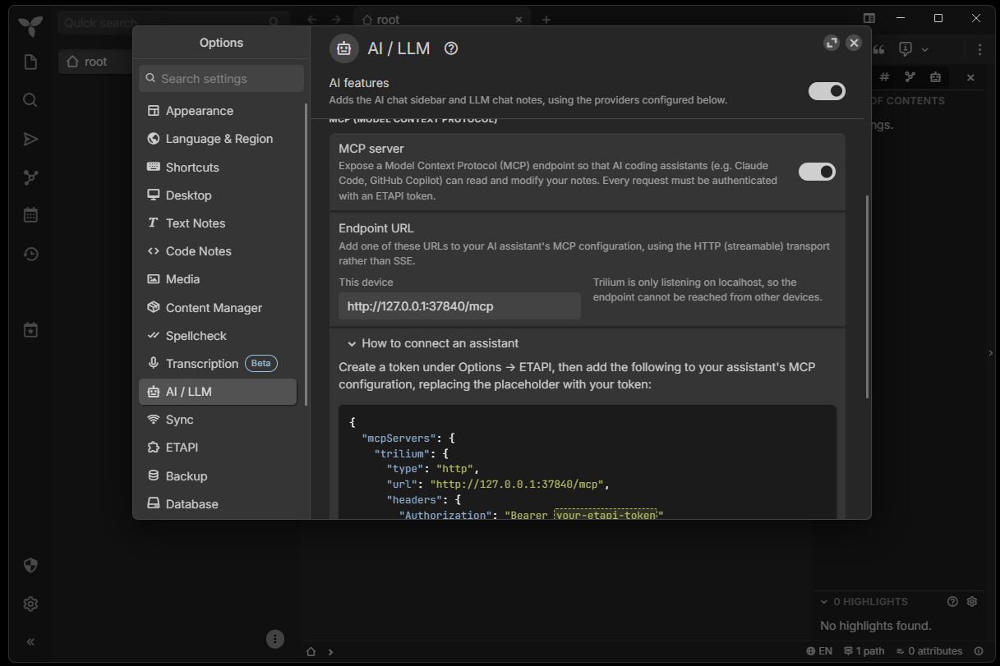

# Installing Trilium Symbiont — details

The [README](../README.md#installing) has the quick way: an agent prompt that runs the install script and
guides you through the rest. This page describes every step by hand, for each client and OS. All commands
run from the repo root.

## Prerequisites

- **Trilium ≥ 0.107.0** ([download](https://triliumnotes.org/get-started/)). Older versions cannot set inheritable attributes over MCP and do not record the
  links in notes written over MCP.
- **The built-in MCP server enabled** (Options → AI/LLM → *MCP server*). Its endpoint URL is shown below
  the toggle, e.g. `https://<your-trilium-host>/mcp`; it must be reachable from the machine running your
  AI client.

  

- **An ETAPI token** (Options → ETAPI). The MCP server accepts it as a Bearer token.

**Token as a user environment variable `TRILIUM_TOKEN`** (the token only, without `Bearer `). The client
configurations below reference it, so the token is not stored in them.

Windows (PowerShell; open a new terminal afterwards, and sign out and in again for apps started from the
Start menu):
```powershell
[Environment]::SetEnvironmentVariable('TRILIUM_TOKEN', '<token>', 'User')
```
Linux / macOS (bash; `~/.profile` is read at login, so log out and in again, or `. ~/.profile` in the
current shell):
```bash
printf "\nexport TRILIUM_TOKEN='%s'\n" '<token>' >> ~/.profile && chmod 600 ~/.profile
```

Set up the client(s) you use (A, B and/or C), then build the skeleton once (section D).

All commands are given for **Windows (PowerShell)** and **Linux / macOS (bash)**; run them from the repo
root. Paths: on Windows `~` means `%USERPROFILE%` (e.g. `C:\Users\<you>`). Keep the repo where it is —
the links point to it; after moving it, re-run the install script (or the link steps).

**Install script (Kiro and Claude Code)** — what the agent prompt in the [README](../README.md#installing)
runs. It does steps 2 and 3 of A and B for you: it links every `sb-*` skill and the steering file into the client's folders (Claude Code: adds the import line to
`~/.claude/CLAUDE.md`). An existing link or an earlier copied folder of the same name is replaced, links
to skills removed from the repo are deleted, everything else is left alone. It needs no Python or Node,
is safe to run again (do so after a `git pull` that adds or removes skills) and `--dry-run` / `-DryRun`
shows what it would change. The MCP server (step 1) stays manual because it involves your token.

Windows (PowerShell; skills become directory junctions, no admin rights needed; the Kiro steering file is
a symlink with Developer Mode or an admin shell, otherwise a copy, and the script says so):
```powershell
powershell -ExecutionPolicy Bypass -File .\scripts\install.ps1 -ClaudeCode   # and/or -Kiro
```
Linux / macOS (bash):
```bash
scripts/install.sh --claude-code                                         # and/or --kiro
```

**Manual alternative — linking the skills** (what the script does; set `$dst` / `DST` to the client's
skills folder). An existing link or an earlier copied folder of the same name is replaced; other skills
are left alone.

Windows (PowerShell; directory junctions need no admin rights):
```powershell
New-Item -ItemType Directory -Force -Path $dst | Out-Null
Get-ChildItem skills -Directory | ForEach-Object {
  $link = Join-Path $dst $_.Name
  if (Test-Path $link) {
    $i = Get-Item $link -Force
    if ($i.LinkType) { $i.Delete() } else { Remove-Item $link -Recurse -Force }
  }
  New-Item -ItemType Junction -Path $link -Target $_.FullName | Out-Null
}
```
(`$i.Delete()` removes only the junction, never the repo folder it points to.)

Linux / macOS (bash):
```bash
mkdir -p "$DST"
for d in "$PWD"/skills/sb-*; do
  l="$DST/$(basename "$d")"
  [ -L "$l" ] || rm -rf "$l"
  ln -sfn "$d" "$l"
done
```

## A — Kiro

1. **MCP server** — add a server named `trilium` to `~/.kiro/settings/mcp.json` (Kiro speaks HTTP MCP
   natively):
   ```json
   {
     "mcpServers": {
       "trilium": {
         "url": "https://<your-trilium-host>/mcp",
         "headers": { "Authorization": "Bearer ${TRILIUM_TOKEN}" }
       }
     }
   }
   ```
   Kiro only expands variables you approve: in Kiro's settings, search for *"Mcp Approved Env Vars"* and
   add `TRILIUM_TOKEN`.
2. **Steering** — link the steering file so plain-language prompts are routed (the install script does
   this; manually:).

   Windows (PowerShell; a file symlink needs Developer Mode or an admin shell — without it, copy the file
   with `Copy-Item` and re-copy after changes):
   ```powershell
   $dir = "$env:USERPROFILE\.kiro\steering"
   New-Item -ItemType Directory -Force -Path $dir | Out-Null
   New-Item -ItemType SymbolicLink -Force -Path "$dir\trilium-symbiont.md" `
     -Target (Resolve-Path steering/trilium-symbiont.md).Path | Out-Null
   ```
   Linux / macOS (bash):
   ```bash
   mkdir -p ~/.kiro/steering
   ln -sfn "$PWD/steering/trilium-symbiont.md" ~/.kiro/steering/trilium-symbiont.md
   ```
3. **Skills** — the install script, or *Linking the skills* (above) with
   `$dst = "$env:USERPROFILE\.kiro\skills"` / `DST=~/.kiro/skills`.

## B — Claude Code

1. **MCP server** — Claude Code speaks HTTP MCP natively, no bridge needed. Add it for all projects.
   `${TRILIUM_TOKEN}` must reach Claude Code literally; Claude Code expands it at start-up from its
   environment. Use the endpoint URL shown under Trilium's MCP toggle: `http://127.0.0.1:37840/mcp` for
   Trilium on the same PC, `https://<your-trilium-host>/mcp` for a server.

   PowerShell and bash (single quotes):
   ```
   claude mcp add --scope user --transport http trilium http://127.0.0.1:37840/mcp --header 'Authorization: Bearer ${TRILIUM_TOKEN}'
   ```
   Windows cmd (double quotes; cmd treats single quotes as ordinary characters and only expands `%…%`):
   ```
   claude mcp add --scope user --transport http trilium http://127.0.0.1:37840/mcp --header "Authorization: Bearer ${TRILIUM_TOKEN}"
   ```
   Check with `claude mcp get trilium` (status should be `✔ Connected`) from a terminal that has
   `TRILIUM_TOKEN` set.
2. **Steering** — Claude Code has no steering folder; the always-on equivalent is the user-level
   `~/.claude/CLAUDE.md`. Import the repo file there by absolute path (no copy, no link; the Kiro
   front-matter is harmless). The install script does this; manually:

   Windows (PowerShell):
   ```powershell
   $dir = "$env:USERPROFILE\.claude"
   New-Item -ItemType Directory -Force -Path $dir | Out-Null
   $md = "$dir\CLAUDE.md"
   $line = '@' + ((Resolve-Path steering/trilium-symbiont.md).Path -replace '\\', '/')
   if (-not ((Test-Path $md) -and (Select-String -Path $md -SimpleMatch $line -Quiet))) {
     Add-Content -Path $md -Value $line
   }
   ```
   Linux / macOS (bash):
   ```bash
   mkdir -p ~/.claude
   line="@$PWD/steering/trilium-symbiont.md"
   grep -qxF "$line" ~/.claude/CLAUDE.md 2>/dev/null || echo "$line" >> ~/.claude/CLAUDE.md
   ```
   The import takes effect in the next Claude Code session.
3. **Skills** — the install script, or *Linking the skills* (above) with
   `$dst = "$env:USERPROFILE\.claude\skills"` / `DST=~/.claude/skills`. Claude Code picks the skills up right away; `/sb-lint` etc. work as slash
   commands, and Claude also uses them on its own when a request matches a skill's description.

## C — Claude Desktop

1. **MCP server** — Claude Desktop starts local (stdio) servers only, so bridge the HTTP endpoint with
   `mcp-remote` (needs Node.js). Add to `claude_desktop_config.json`:
   - Windows: `%APPDATA%\Claude\claude_desktop_config.json`
   - Linux: `~/.config/Claude/claude_desktop_config.json`
   - macOS: `~/Library/Application Support/Claude/claude_desktop_config.json`

   Claude Desktop passes only a few standard variables to the server process, not `TRILIUM_TOKEN`; the
   config has to bring the token in.

   Linux / macOS: start the bridge through a login shell, which reads `~/.profile` and with it
   `TRILIUM_TOKEN`. With nvm, put the directory of `which npx` in front of `PATH` (non-interactive shells
   don't load nvm); without nvm, drop the `PATH=… ` part.
   ```json
   {
     "mcpServers": {
       "trilium": {
         "command": "/bin/bash",
         "args": ["-lc", "PATH=/home/<you>/.nvm/versions/node/<version>/bin:$PATH exec npx -y mcp-remote https://<your-trilium-host>/mcp --header \"Authorization:Bearer $TRILIUM_TOKEN\""]
       }
     }
   }
   ```
   Restart Claude Desktop.

   Windows: Claude Desktop neither expands `${VAR}` in its config nor passes user environment variables
   to MCP servers. The working setup lets `node.exe` read `TRILIUM_TOKEN` from the registry
   (`HKCU\Environment`) at start-up and hand it to `mcp-remote`, so the token never sits in the config.
   Let Claude Desktop write it: paste this prompt into a Desktop chat (not a project). The URL fits
   Trilium on the same PC; for a Trilium server, put in the endpoint shown under its MCP toggle:
   ```text
   Install the Trilium MCP server in Claude Desktop on Windows (chat side, not Claude Code).
   Find claude_desktop_config.json (usually %APPDATA%\Claude\ or under %LOCALAPPDATA%\Claude-Data\…),
   back it up, and add mcpServers.trilium while keeping all other keys.
   URL: http://127.0.0.1:37840/mcp. Header: Authorization: Bearer TOKEN, where TOKEN comes from my user
   env var TRILIUM_TOKEN.
   Claude Desktop doesn't expand ${VAR} in its config and doesn't pass user env vars to MCP servers.
   So use command node.exe (full path) with args ["-e", ONE-LINER]. The one-liner reads TRILIUM_TOKEN
   from HKCU\Environment (reg query), exits if it's missing, then spawns (shell:true, stdio:inherit)
   npx.cmd -y mcp-remote URL --header "Authorization:${TRILIUM_AUTH}" with TRILIUM_AUTH="Bearer TOKEN"
   in its env.
   Install Node.js LTS first if it's missing.
   Never write or print the token. Validate the JSON. Before I restart, test the exact command from the
   config with TRILIUM_* removed from the env: initialize + tools/list must return tools.
   Then I quit Claude from the tray and restart; check %LOCALAPPDATA%\Claude\logs\mcp-server-trilium.log.
   ```
   Quit Claude Desktop from the tray icon (closing the window is not enough) and start it again. If the
   server does not connect, read `%LOCALAPPDATA%\Claude\logs\mcp-server-trilium.log`.
2. **Steering** — create a Claude project (e.g. "Trilium Symbiont") and paste the content of
   `steering/trilium-symbiont.md` (without the front-matter) into its **project instructions**. Chats
   in that project then get the routing rules. (Personal preferences under Settings → Profile also work,
   but apply to every chat.)
3. **Skills** — Claude Desktop installs skills as ZIP uploads (code execution must be enabled).

   **Download** (no clone, no build): every [release](https://github.com/chaeller/trilium-symbiont/releases/latest) has the 12 skill ZIPs
   attached, built from that release by `.github/workflows/release.yml`.

   **Or build them yourself** (from a clone, e.g. for changes not yet released): one
   ZIP per skill, each containing its folder (the `sb-init` ZIP thereby includes its `assets/`; the
   `sb-daily` and `sb-hub` ZIPs also get the templates they share with `sb-init`), with
   the build script — `build_dist.mjs` (Node ≥ 18; Node is already needed for `mcp-remote`) or its twin
   `build_dist.py` (Python ≥ 3.8); both build identical ZIPs and need no dependencies. It
   rewrites each ZIP from scratch (no leftover files), uses forward-slash paths on every OS, and with no
   arguments builds all skills and removes ZIPs of deleted skills. Name skills to build only those.
   `dist/` is git-ignored.

   Windows (PowerShell):
   ```powershell
   node scripts\build_dist.mjs             # all skills (or: py scripts\build_dist.py)
   node scripts\build_dist.mjs sb-daily    # only the named ones
   ```
   Linux / macOS (bash):
   ```bash
   node scripts/build_dist.mjs             # all skills (or: python3 scripts/build_dist.py)
   node scripts/build_dist.mjs sb-daily    # only the named ones
   ```
   **Install:** upload every ZIP (downloaded, or from `dist/`) under **Settings → Skills**. If you uploaded `sb-*` skills
   there before, **delete the old ones first** — otherwise the old and the new version sit side by side.
   Claude Desktop picks a skill from its description; you can also name it explicitly
   (*"use sb-triage"*).

   **Update:** for a new release, download its ZIPs; after changing a skill yourself (its `SKILL.md` or
   `assets/`), rebuild its ZIP. Then delete the old skill in Settings → Skills and upload the new ZIP —
   Desktop does not see repo changes.

## D — Build the skeleton and verify (new instance)

1. **Build the skeleton** — on an empty Trilium instance, run **`/sb-init`** (in Claude Desktop: *"use
   sb-init"*). Following `skeleton.md`, it creates `_README`, the umbrella `_Schema` (`#sbVersion=1.0.0`), the
   four spaces with their `_Schema` notes, the journal configuration on Daily (week level, title patterns,
   day and week templates), the Kanban Board with its board config, the Cockpit saved searches and
   Proposals, `Hubs/_Index`, the Principles hub, the hub and synthesis templates, and Sources with its
   groups — ID-free, so it works on any instance. It asks for confirmation before creating under `root`
   and refuses if a `#sbSpace` space already exists.
2. **Verify** — run `/sb-lint`; it loads the umbrella `_Schema` first (found by label) and reports on the
   system's health. If the umbrella `_Schema` is found and lint runs, the install is live.

## E — Updating

The [README](../README.md#updating) has an agent prompt that does these steps for you.

**Within a major version** (e.g. `1.0.0` → `1.1.0`; read the release's *Upgrade* notes in
[CHANGELOG.md](../CHANGELOG.md) first):
```bash
git pull
```
- **Kiro / Claude Code** link to the repo, so updated skills and steering are live at once. Re-run the
  install script when a release adds or removes a skill.
- **Your Trilium instance:** run **`/sb-sync`**. It shows how the rulebooks, templates and icons differ
  from the repo and applies only what you confirm (same major version; it never writes live → repo).
- **Claude Desktop** holds copies: download the release's ZIPs (or rebuild them) and re-upload the
  changed skills (section C, step 3),
  and update the project instructions if the steering changed (section C, step 2).
- If the steering changed, start a new session; then run `/sb-lint`.

**A new major version** (e.g. `2.0.0`): `#sbVersion` is a semantic version, and only **minor and patch**
releases are backward-compatible. A new major version is not migrated by this repo: an instance whose
umbrella `_Schema` has a different major version is treated as an **unsupported instance** — `/sb-lint`
reports it and the agent stops rather than operating on it.
